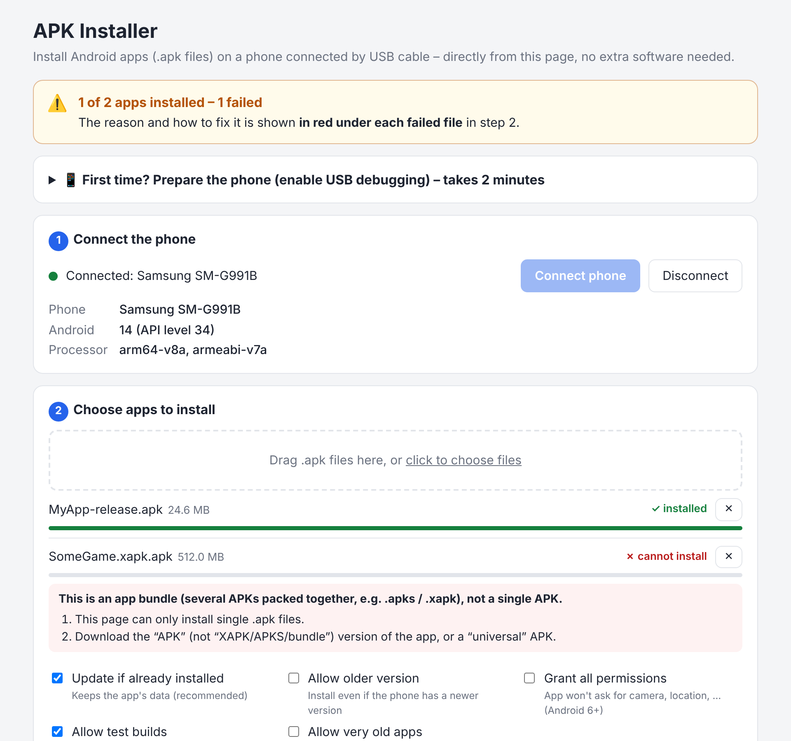

# APK Installer (WebUSB)

Install Android apps (`.apk` files) on a phone connected by USB – **directly from the browser**.
No adb, no Android Studio, no drivers on most systems, nothing to install. Everything is in a single HTML file.

**▶ Open it: https://crunchy3d.github.io/webusb-apk-installer/** (Chrome or Edge)



## Features

- Install one or many `.apk` files with drag & drop, with a progress bar for each file
- Built-in step-by-step guide for enabling **USB debugging** (Samsung, Pixel, Xiaomi, Huawei, OnePlus/OPPO/Realme, Vivo, …)
- Plain-language messages: what is happening, and **what to do when something goes wrong**
  (phone not found, in use by another program, “Allow USB debugging?” prompt, ~20 common Android install errors)
- Checks files *before* installing: detects app bundles (`.apks`/`.xapk`/`.aab`), broken downloads, saved web pages, and APKs built for a different processor
- Options: update existing app, allow downgrade, grant all permissions, allow test builds, allow very old apps (Android 14+)
- List and uninstall user-installed apps
- Technical log with a **Copy log** button for support requests
- Works with Android 5 and newer (fast streamed install on Android 7+)

## Requirements

| | |
|---|---|
| Browser | **Google Chrome** or **Microsoft Edge** (desktop) – any browser with [WebUSB](https://caniuse.com/webusb). Firefox and Safari are **not** supported. |
| Computer | Windows, macOS, Linux or ChromeOS |
| Phone | Android 5.0+ with **USB debugging** enabled (the page explains how) |
| Cable | A USB **data** cable (some cables only charge) |

## Usage

### Option A – online (easiest)

1. Open **https://crunchy3d.github.io/webusb-apk-installer/** in Chrome or Edge.
2. Follow the three steps on the page: prepare the phone (first time only) → **Connect phone** → choose APK files → **Install**.

The page runs entirely in your browser. APK files are sent **only** to your phone over USB – nothing is uploaded to any server.

### Option B – offline / local file

1. Download the latest `APK_Installer_V_0_x.zip` from [Releases](../../releases) (or `versions/apk_installer_V_0_x.html` from this repository).
2. Unzip it and double-click **`Start_APK_Installer.bat`** (Windows) – it opens the installer in **Microsoft Edge** even if your default browser is different.
   On macOS/Linux, simply open the `.html` file in Chrome or Edge.

## Troubleshooting

| Problem | Solution |
|---|---|
| Phone is not in the list after clicking *Connect phone* | Enable USB debugging, unlock the phone, use a data cable, re-plug. On Windows you may need the phone maker's USB driver. |
| “The phone is being used by another program” | Close Android Studio, scrcpy, phone-manager software and other tabs with this page; run `adb kill-server` if adb is installed. |
| Phone never asks “Allow USB debugging?” | Unlock the screen; in Developer options tap *Revoke USB debugging authorizations*, toggle USB debugging, re-plug. |
| Install blocked on Xiaomi / Vivo / OPPO | Enable *Install via USB* in Developer options and confirm the install on the phone screen. |
| Linux: “Access denied” | Install udev rules (`android-sdk-platform-tools-common` or `android-udev`) and add your user to the `plugdev` group. |

More help is built into the page (sections *Troubleshooting* and the explanation shown under every failed file).

## How it works

The page implements the [ADB protocol](https://android.googlesource.com/platform/packages/modules/adb/+/refs/heads/main/protocol.txt) in plain JavaScript on top of the browser's [WebUSB API](https://developer.mozilla.org/docs/Web/API/WebUSB_API):

- **Authentication:** a 2048-bit RSA key is generated once with WebCrypto and stored in the browser's `localStorage`. The phone asks you once to trust it (“Allow USB debugging?”).
- **Install (Android 7+):** the APK is streamed into `cmd package install -S <size>`.
- **Install (Android 5–6):** the APK is copied to `/data/local/tmp` with the ADB sync protocol and installed with `pm install`.

No external libraries, no build step, no network access – one self-contained HTML file.

## Privacy & security

- No data leaves your computer except to the phone you select. There is no analytics or tracking, and the page makes no network requests.
- The browser only gives the page access to a USB device after you pick it in the browser's own device chooser.
- The ADB key is stored only in your browser. Use **Reset connection key** in the page (Technical log section) to delete it. You can also revoke access on the phone (*Developer options → Revoke USB debugging authorizations*).
- Only install APKs from sources you trust.

## Repository layout

```
index.html                  latest version (served by GitHub Pages)
versions/                   all released versions (apk_installer_V_0_x.html)
Start_APK_Installer.bat     Windows launcher: opens the newest local version in Edge
docs/screenshot.png
```

## Contributing

Bug reports and suggestions are welcome – please [open an issue](../../issues) and paste the output of **Copy log** (from the *Technical log* section of the page).

## License

Written by Damir Vrancic and Claude.

[MIT](LICENSE) © 2026 Damir Vrancic
